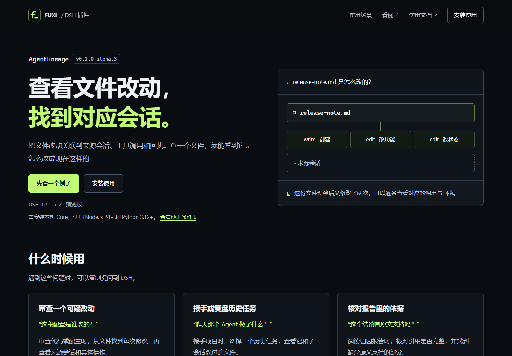
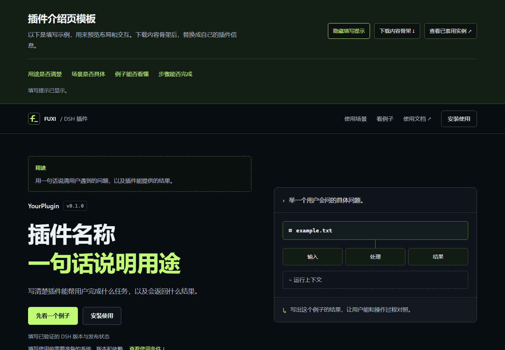
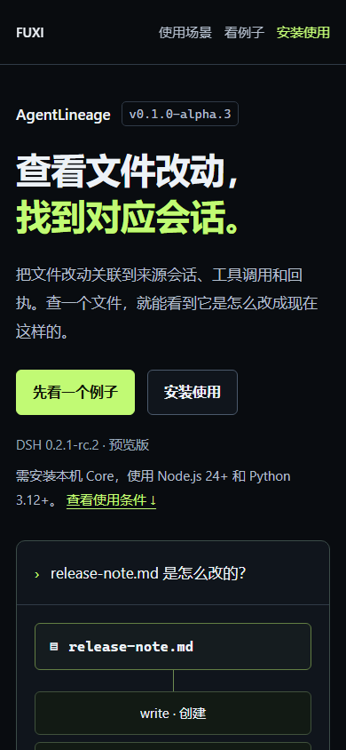

# 插件介绍页：字号与使用路径调整

AgentLineage 和通用模板在浏览器 100% 缩放下使用相同的字号与布局。桌面正文 17px、首屏介绍 19px，手机正文 16px，代码 15px，辅助文字至少 14px。窄屏改为单列和纵向步骤。

## 内容调整

阅读顺序为用途、使用场景、最小例子、前后对比、使用条件、安装与验证。首屏可直接查看依赖，详细条件位于安装之前。安装验证与交互和录像使用同一个发布说明例子，每步列出完成后应看到的结果，侧栏可跳到具体步骤。

去掉装饰性英文标签、重复口号和没有实际用途的字段。文案直接说明用户的问题、操作和结果。模板的写作说明见[填写指南](../plugin-page-template.md)，下载的内容骨架包含运行条件和每步成功标志。

## 模板预览

[线上模板](https://fuxi-ailabs.github.io/dsh-plugin-market/templates/plugin-page/)与 [AgentLineage](https://fuxi-ailabs.github.io/dsh-plugin-market/plugins/agentlineage/)由同一生成器输出。模板可以隐藏填写提示、下载骨架、操作示例及放大占位图。

## 浏览器验证

使用独立 Chromium 无头浏览器、本地预览、默认 16px 根字号和 100% 缩放。AgentLineage 与模板分别检查 360、390、768、1024、1440、1920px，共 12 组布局，无横向溢出；可见说明、代码和控件文字不小于 14px。

两页的步骤选择、结果与细节标签页、键盘 Home 切换、复制、截图放大与 Escape 关闭、自动演示及手动打断、安装步骤跳转和条件展开均通过。另检查了手动复制回退、模板提示开关、内容骨架下载、视频 Range 请求，以及关闭 JavaScript 后的结论和安装步骤。未发现脚本异常或失败资源。

[浏览器检查记录](assets/plugin-page-readability-check.json) · [桌面完整截图](assets/agentlineage-desktop.png) · [手机完整截图](assets/agentlineage-mobile.png)

`npm run ci` 通过：生成结果一致性、市场索引与发布资源校验、DSH 版本及来源策略检查。

页面交互仍使用标明来源的固定示意数据；既有真实 DSH 录像及插件版本保持原样。[录像来源与剪辑说明](../demos/agentlineage-recording.md)。本次检查针对介绍页和模板。
